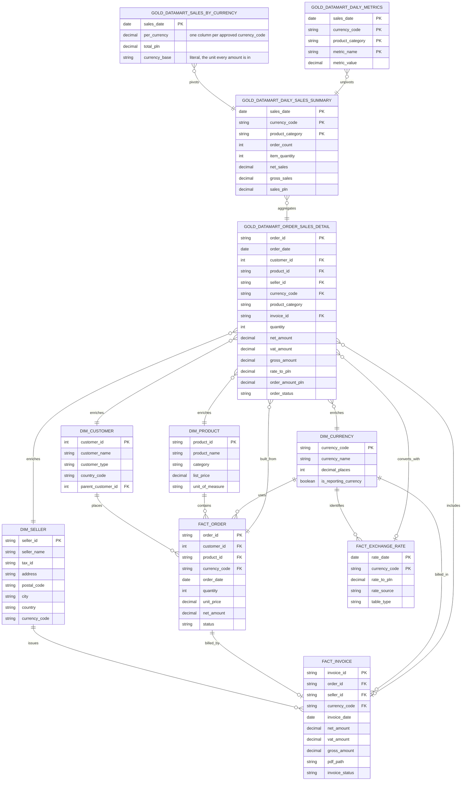

# Tables built

Every object the flows create, by layer. Schemas are `bronze_raw`, `silver` and
`gold` in the catalog the bundle target names — `poc_dev`, `poc_test` or `poc`.
In the `dev` target, development mode prefixes each schema with `dev_<user>_`.

EXERCISE deliverable 2. The write mode and the reason for it are in each flow's
own README, linked in the last column.

## Bronze — 9 objects

| Object | Type | Source | Write mode | Flow |
|---|---|---|---|---|
| `bronze_currency` | table | `currencies.csv` | full overwrite | [01](../src/flow01/README.md) |
| `bronze_exchange_rate_hist` | **view** | `exchange_rates_historical.csv` | n/a | [01](../src/flow01/README.md) |
| `bronze_exchange_rate_current` | table | NBP API, one call per currency | full overwrite | [01](../src/flow01/README.md) |
| `bronze_product` | table | `products_excel/*.xlsx` | append, Auto Loader | [02](../src/flow02/README.md) |
| `bronze_seller` | table | `sellers_delta/` | append | [02](../src/flow02/README.md) |
| `bronze_customer` | table | `customer_data/*.csv` | append + `mergeSchema` | [03](../src/flow03/README.md) |
| `bronze_invoice` | table | `invoices/*.pdf`, as `VARIANT` | append | [04](../src/flow04/README.md) |
| `bronze_order` | table | four order Parquet deliveries | append, one with `mergeSchema` | [05](../src/flow05/README.md) |
| `bronze_order_status_changes` | table | `order_status_changes.parquet` | append, Auto Loader | [05](../src/flow05/README.md) |

`bronze_exchange_rate_hist` is the one view in the project, because flow 01 asks
for a view rather than a managed table. Everything else is a table, as
EXERCISE.md requires.

`bronze_order` is written by three notebooks and fed by four files, which is why
the table holds 48 rows for 32 order ids: two deliveries replay rows the first
already sent, one adds `sales_channel`, and the fourth carries two deliberately
invalid orders.

That fourth file, `orders_stream_bad_data.parquet`, is what makes EXERCISE
deliverable 6 reproducible. Anyone who uploads `data/` and runs the flows gets a
real quarantine row rather than a transcript of one: both its rows break an
`error` rule, so neither reaches `silver_order`, which stays at 30 orders, and
no figure in Silver or Gold is affected by it. The two rows and the rule each
breaks are listed in [flow 05's README](../src/flow05/README.md).

## Silver — 9 tables

| Table | Source | Write mode | Quality gate | Flow |
|---|---|---|---|---|
| `silver_currency` | `bronze_currency` | overwrite | `silver_currency.yml` | [01](../src/flow01/README.md) |
| `silver_exchange_rate` | the two exchange-rate Bronze objects | replace the incoming dates | `silver_exchange_rate.yml` | [01](../src/flow01/README.md) |
| `silver_product` | `bronze_product` | overwrite | `silver_product.yml` | [02](../src/flow02/README.md) |
| `silver_seller` | `bronze_seller` | overwrite | `silver_seller.yml` | [02](../src/flow02/README.md) |
| `silver_customer` | `bronze_customer` | overwrite | `silver_customer.yml` | [03](../src/flow03/README.md) |
| `silver_invoice` | `bronze_invoice` | overwrite | `silver_invoice.yml` | [04](../src/flow04/README.md) |
| `silver_order` | `bronze_order` | merge on `order_id`, deleting what stops passing | `silver_order.yml` | [05](../src/flow05/README.md) |
| `silver_order_status_history` | `bronze_order_status_changes` | `AUTO CDC`, SCD Type 2 | `silver_order_status_history.yml` | [05](../src/flow05/README.md) |
| `silver_dq_quarantine` | rows every gate rejects | append | — | [06](../src/flow06/README.md) |

`silver_dq_quarantine` is shared by all eight gates and told apart by
`source_table`. Its shape and the projection into it live in
[src/common/dq.py](../src/common/dq.py), so no gate writes that SQL itself.

`silver_order_status_history` is the only object built by a pipeline rather than
a notebook, because `AUTO CDC` is pipeline-only.

## Gold — 11 tables

Four dimensions and three facts, then four marts on top of them.

| Table | Source | Flow |
|---|---|---|
| `dim_currency` | `silver_currency` | [01](../src/flow01/README.md) |
| `dim_product` | `silver_product` | [02](../src/flow02/README.md) |
| `dim_seller` | `silver_seller` | [02](../src/flow02/README.md) |
| `dim_customer` | `silver_customer` | [03](../src/flow03/README.md) |
| `fact_exchange_rate` | `silver_exchange_rate` | [01](../src/flow01/README.md) |
| `fact_invoice` | `silver_invoice` + `dim_seller` | [04](../src/flow04/README.md) |
| `fact_order` | `silver_order` | [05](../src/flow05/README.md) |
| `gold_datamart_order_sales_detail` | all seven above | [06](../src/flow06/README.md) |
| `gold_datamart_daily_sales_summary` | `gold_datamart_order_sales_detail` | [06](../src/flow06/README.md) |
| `gold_datamart_sales_by_currency` | `gold_datamart_daily_sales_summary` + `dim_currency` | [06](../src/flow06/README.md) |
| `gold_datamart_daily_metrics` | `gold_datamart_daily_sales_summary` | [06](../src/flow06/README.md) |

Every Gold table is a full overwrite. Each is the whole of its source, so there
is nothing to merge.

`gold_datamart_sales_by_currency` is the only table in the project without a
declared schema: section 4 of flow 06 asks for one column per currency, so its
shape follows `dim_currency` and the write replaces the schema.

## Beyond DATA_MODEL.md

Three Silver tables are not in the data model and exist because Gold needs a
checked source rather than a Bronze one:

| Table | Why |
|---|---|
| `silver_product` | `dim_product` would otherwise be built from untyped, undeduplicated, ungated rows |
| `silver_seller` | the same, and `fact_invoice` resolves `seller_id` against `dim_seller` |
| `silver_currency` | `dim_currency` is the approved reference list the conversion depends on |

Flow 02's document says "Bronze only" and names no Silver table, so the first
two are an addition. The alternative was publishing Bronze rows straight into
the published contract.

Two Gold marts are likewise not in the data model: flow 06 section 4 specifies
`gold_datamart_sales_by_currency` and `gold_datamart_daily_metrics` as reporting
sinks, and `docs/INGESTION_PLAN.md` lists them as flow 06's outputs.

## Final ER diagram

EXERCISE deliverable 5. This is the Gold layer as built. It is the diagram from
[DATA_MODEL.md](DATA_MODEL.md) with the three differences listed under it, and
that document is left as it was given.

Three differences from the target model:

| Difference | Why |
|---|---|
| `GOLD_DATAMART_SALES_BY_CURRENCY` and `GOLD_DATAMART_DAILY_METRICS` are present | Flow 06 section 4 specifies both as reporting sinks, and `INGESTION_PLAN.md` lists them as flow 06's outputs. `DATA_MODEL.md` does not declare either. |
| `GOLD_DATAMART_ORDER_SALES_DETAIL` carries `product_category` | Section 3 groups that table by category to build the daily summary, and `DATA_MODEL.md` names it as the summary's only source. Both statements hold only if the column is there. |
| `GOLD_DATAMART_SALES_BY_CURRENCY` has no fixed column list | Section 4 asks for one column per currency, so the set follows `DIM_CURRENCY` rather than the diagram. |

The Silver tables are not in the diagram, for the same reason they are not in
`DATA_MODEL.md`: it models the Gold layer's meaning. The three Silver tables
built beyond the model are listed above under
[Beyond DATA_MODEL.md](#beyond-datamodelmd).
