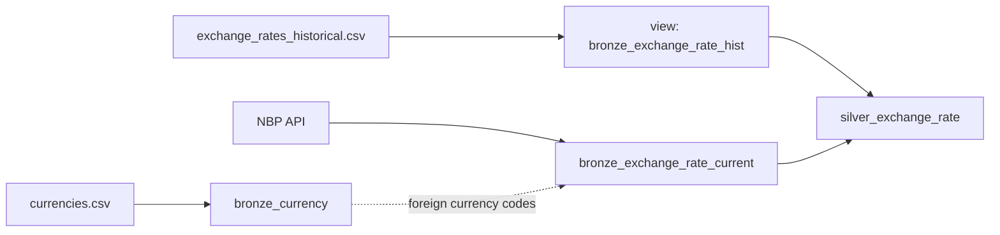

# Flow 01 — Currency & Exchange Rate

Builds the currency reference data and a daily exchange-rate table that combines a historical CSV with current rates from the NBP (Narodowy Bank Polski) API.

Requirements: [flows/flows/01_currency_exchange_rate.md](../../flows/flows/01_currency_exchange_rate.md), plus the general rules in [docs/EXERCISE.md](../../docs/EXERCISE.md), [docs/DATA_MODEL.md](../../docs/DATA_MODEL.md) and [docs/INGESTION_PLAN.md](../../docs/INGESTION_PLAN.md).

## What gets built

| Layer | Object | Type | Source | Write mode | Notebook |
|---|---|---|---|---|---|
| Bronze | `bronze_currency` | table | `currencies.csv` | full overwrite | `01_load_bronze_currency.py` |
| Bronze | `bronze_exchange_rate_hist` | **view** | `exchange_rates_historical.csv` | n/a (view) | `02_create_bronze_exchange_rate_hist.py` |
| Bronze | `bronze_exchange_rate_current` | table | NBP API | full overwrite | `03_load_bronze_exchange_rate_current.py` |
| Silver | `silver_exchange_rate` | table | the two exchange-rate Bronze objects | replace the incoming dates | `04_build_silver_exchange_rate.py` |
| Silver | `silver_dq_quarantine` | table | rows the quality gate rejects | append | `04_build_silver_exchange_rate.py` |
| Silver | `silver_currency` | table | `bronze_currency` | overwrite | `05_build_silver_currency.py` |
| Gold | `dim_currency` | table | `silver_currency` | full overwrite | `06_build_gold_dim_currency.py` |
| Gold | `fact_exchange_rate` | table | `silver_exchange_rate` | full overwrite | `07_build_gold_fact_exchange_rate.py` |

All objects live in the catalog chosen by the bundle target (`poc_dev`, `poc_test`, `poc`). Bronze objects are in schema `bronze_raw`, Silver in `silver`. In the `dev` target, development mode prefixes schema names with `dev_<user>_`.

Solid arrows are data lineage, the dashed arrow is a parameter dependency: `bronze_currency` decides which currencies are called, but none of its columns reach Silver.



## Jobs and triggers

Defined in [resources/flow01_currency_job.job.yml](../../resources/flow01_currency_job.job.yml) and [resources/flow01_exchange_rate_job.job.yml](../../resources/flow01_exchange_rate_job.job.yml). Both use notebook tasks only, on serverless environment version 6.

| Job | Runs | Trigger |
|---|---|---|
| `load_bronze_currency` | steps 1, 5 and 6 | manual — someone approves a currency change |
| `build_silver_exchange_rate` | steps 2–4 and 7 | table update on `bronze_currency` |

The split follows what each step reads. `silver_currency` and `dim_currency` need only `bronze_currency`, so they are tasks of the job that writes it; the rates need both Bronze sources, so they are tasks of the job the first one triggers.

Inside `build_silver_exchange_rate`, steps 2 and 3 run in parallel — step 3 only needs `bronze_currency`, not the view — and step 4 waits for both. Each Gold build waits for its own Silver source, so a projection is never taken from a table a failed gate left half-written.

Both Gold tables are watched by flow 06's mart job, so publishing either starts a mart rebuild five minutes later.

The catalog, schema and volume names are job-level parameters, filled in by the bundle, and read by every notebook through widgets.

## Approach per step

### Step 1 — `bronze_currency`

- Batch read (`spark.read`) of `currencies.csv` with an explicit schema: `decimal_places` as INT, `is_reporting_currency` as BOOLEAN.
- Adds `source_file` and `ingested_at`.
- Full overwrite on every run. The table is small and changes rarely.
- Batch, not Auto Loader: the job is started manually and should always rebuild the table from the file, also when a corrected file is uploaded under the same name.

### Step 2 — `bronze_exchange_rate_hist` (view)

- `CREATE OR REPLACE VIEW` over `read_files(...)` with an explicit schema. No schema inference.
- Column names and format stay as in the source, which matches the NBP API (`table`, `currency`, `code`, `no`, `effectiveDate`, `mid`).
- `mid` is `DECIMAL(18,6)`, not DOUBLE, because rates are used in money calculations.
- A view has no load moment, so `ingested_at` is the file's modification time. `source_file` is the file name.

### Step 3 — `bronze_exchange_rate_current`

- Reads the currency codes from `bronze_currency`, taking the ones marked `is_reporting_currency = false` (so PLN is left out in the current file).
- Calls the NBP API once per currency with the Databricks `http_request()` SQL function, through a Unity Catalog HTTP connection `nbp_api`. The notebook creates the connection if it does not exist.
- Endpoint: current mid rate from table A, `https://api.nbp.pl/api/exchangerates/rates/A/{code}/?format=json`.
- The JSON is parsed with an explicit schema into exactly the same columns and types as the historical view, so Silver can combine both directly.
- A non-200 response stops the task: the status check and the JSON parse are the two branches of one `CASE`, so the parsed column either holds a payload or raises.
- The rates array is flattened with `explode_outer`, not `explode`. A 200 response that parsed to no rates therefore lands as a row with NULL `no`, `effectiveDate` and `mid` instead of disappearing. NBP answers an unknown code with 404 rather than an empty 200, so this is a safety net rather than an expected path — but it means a malformed response is visible in Bronze for flow 06 to catch, rather than a currency silently going missing.
- `source_file` is the API URL, `ingested_at` is the load time.
- Full overwrite: the table only holds the latest snapshot.

### Step 4 — `silver_exchange_rate`

- Combines the view and the API table with `unionByName`. All Bronze columns are kept, including `source_file` and `ingested_at`.
- Deduplication with a window: one row per `effectiveDate` + `code`, the API row first, then the latest `ingested_at`.
- The schema is declared with `CREATE TABLE IF NOT EXISTS`, so the shape is pinned for Gold rather than taken from whatever the query produced. `` `table` `` needs backticks there, being a reserved word. `code` and `effectiveDate` are `NOT NULL` — they are the pair the write replaces on and the pair uniqueness is defined over.
- The rows then go through the quality gate; see [Data quality](#data-quality).
- The rows that pass are written with `.option("replaceUsing", "effectiveDate")`, which deletes the Silver rows whose `effectiveDate` matches an incoming row and inserts the incoming ones. Dates absent from the source keep their existing rows.

## Approach — Gold

Both Gold tables are published by Job B, after Silver, so a projection is never taken from a Silver table a failed quality gate left half-written. Neither has a quality gate of its own: the project's rules put DQX at the Bronze to Silver boundary, so a row reaching Gold has already passed one.

### `dim_currency`

A projection — the four columns `DIM_CURRENCY` declares, in its order, and nothing else. `source_file` and `ingested_at` stop at Silver; they are lineage for that layer, not attributes of a currency. Every column has a source, so unlike `dim_product` and `dim_customer` there is no NULL placeholder here.

### `fact_exchange_rate`

The one Gold build in the project that renames. Silver keeps the NBP API's own column names, because the quality requirement writes them that way — "unique (`effectiveDate`, `code`), positive `mid`" — so the rename to the data model happens here:

| Silver | Gold |
|---|---|
| `effectiveDate` | `rate_date` |
| `code` | `currency_code` |
| `mid` | `rate_to_pln` |
| `table` | `table_type` |

`table_type` is always `A`. Both sources are NBP table A by design: the API path is fixed to `/rates/A/` and the historical CSV carries `A` on every row. Table A holds the mid rates, which is what matches the historical file and what a single `rate_to_pln` needs — table C would publish a buy and a sell rate and leave the choice open. The column is in the model to tell the tables apart if B or C were ever added.

`rate_source` is carried through from Silver rather than worked out here. `silver_exchange_rate` sets it where the two Bronze sources are combined, which is the one place the distinction cannot be mistaken; deriving it here by matching `source_file` against the API host would reconstruct something already known, and would label every rate as coming from the CSV if the two ever disagreed about the host.

Two columns stop at Silver: `currency` is the currency's name, which belongs to `DIM_CURRENCY` as `currency_name` rather than to a fact, and `no` is the NBP bulletin number, which the model does not declare.

## Data quality

The gate runs at the Bronze to Silver boundary. Rules live in [checks/silver_exchange_rate.yml](../../checks/silver_exchange_rate.yml), not in the notebook, and the bundle ships the file to the workspace — the notebook receives its path as the `checks_path` job parameter.

| Rule | Function | Category | Criticality |
|---|---|---|---|
| `effective_date_is_null` | `is_not_null` | completeness | error |
| `code_is_null` | `is_not_null` | completeness | error |
| `effective_date_code_is_not_unique` | `is_unique` | uniqueness | error |
| `mid_is_not_positive` | `sql_expression` | validity | error |
| `code_not_in_bronze_currency` | `foreign_key` | referential integrity | warn |

An `error` row goes to `silver_dq_quarantine` and not to Silver. A `warn` row goes to both: a currency missing from reference data is recorded but is not a reason to lose a published rate.

`silver_dq_quarantine` is a project-wide table shared by every quality gate, told apart by `source_table` — don't drop it when rebuilding. Its shape and the projection into it live in [src/common/dq.py](../common/dq.py), so no gate writes that SQL itself.

One interaction worth knowing: `replaceUsing` rewrites a date whenever the incoming data has any row for it. So if one rate for a date is quarantined and another passes, the date is rewritten from the passing rows alone and the quarantined pair disappears from Silver rather than keeping an earlier value. If every row for a date is quarantined, the date is absent from the incoming frame and its existing rows are left alone.

The rules are covered by [tests/test_quality_gate.py](../../tests/test_quality_gate.py), which validates every rule file without needing compute.

## Design decisions not specified in the requirements

| Topic | Decision | Reason |
|---|---|---|
| NBP endpoint | Per-currency current rate, table A | The flow says "call the NBP API" without an address. Table A holds mid rates, matching the historical file. |
| API call | `http_request()` + UC HTTP connection | Flow step 5: prefer a native Databricks solution over an external package. |
| Rate type | `DECIMAL(18,6)` | Exact arithmetic for money; NBP returns up to 4 decimals for these currencies. |
| Which currencies to call | `is_reporting_currency = false`, not a literal `'PLN'` | The flow says "every currency except PLN". The flag in `currencies.csv` marks exactly that row, so the rule is read from the data instead of being hardcoded, and a change of reporting currency needs no code change. NBP publishes foreign rates against PLN, so there is no endpoint for the reporting currency itself. The condition is stated directly rather than defaulting a missing flag, so only currencies the file explicitly marks `false` are called. |
| `ingested_at` in the view | File modification time | A view has no load moment of its own. |
| Which row wins on a duplicate | **NBP API first**, then latest `ingested_at` | Flow 06 asks to "define what latest means". The API is the bank's own published source; the CSV is a copy. |
| Silver schema | Declared, not derived | `silver_exchange_rate` is consumed by Gold, so the shape is pinned in DDL. A query that stopped producing these types fails the write instead of quietly changing the table. |
| Foreign key criticality | `warn` | A currency missing from reference data must not cost a published rate. |
| Silver column names | Same as Bronze | No renaming required by the flow; renaming to the data model names can happen in Gold. |
| File location | `/Volumes/<catalog>/bronze_raw/input_data/data/currencies_exchanges/` | The sources are grouped by domain in the volume, `currencies_exchanges/` for both of flow 01's files, and the two notebooks name their file exactly rather than globbing the folder. |

## Deploy and run

```bash
databricks bundle deploy -t dev
databricks bundle run load_bronze_currency -t dev
```

`load_bronze_currency` writes `bronze_currency`, and the table update trigger then starts `build_silver_exchange_rate` in every target. Table update triggers are checked periodically, so the run can start shortly after the first job finishes rather than immediately.

Development mode normally pauses all job triggers. The trigger in [flow01_exchange_rate_job.job.yml](../../resources/flow01_exchange_rate_job.job.yml) sets `pause_status: UNPAUSED` explicitly, so it stays active in dev too. (A target-level preset `trigger_pause_status: UNPAUSED` is rejected by the CLI in development mode.) To run the second job without waiting for the trigger:

```bash
databricks bundle run build_silver_exchange_rate -t dev
```

**First deploy to a new catalog (test, prod):** Databricks checks that the trigger table exists when it creates `build_silver_exchange_rate`. On an empty catalog, run the steps in this order:

1. `databricks bundle deploy -t test` (creates the schemas, volume and the first job; the second job fails)
2. Upload `currencies.csv` and `exchange_rates_historical.csv` to the volume's `data/` folder
3. `databricks bundle run load_bronze_currency -t test`
4. `databricks bundle deploy -t test` (now creates the second job)

