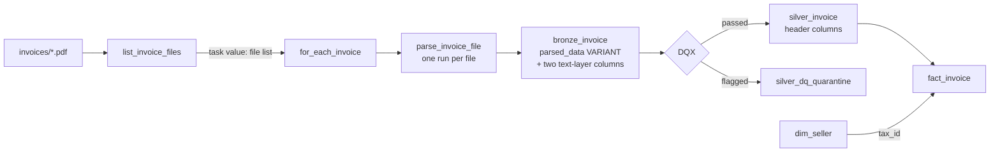

# Flow 04 — Invoices

Parses invoice PDFs into a Bronze `VARIANT` table, then flattens the headers into Silver and publishes the fact.

Requirements: [flows/flows/04_invoices.md](../../flows/flows/04_invoices.md), plus the general rules in [docs/EXERCISE.md](../../docs/EXERCISE.md), [docs/DATA_MODEL.md](../../docs/DATA_MODEL.md) and [docs/INGESTION_PLAN.md](../../docs/INGESTION_PLAN.md).

## What gets built

| Layer | Object | Type | Source | Write mode | Notebook |
|---|---|---|---|---|---|
| Bronze | `bronze_invoice` | table | `data/invoices/*.pdf` | append | `01_list_invoice_files.py`, `02_parse_invoice_file.py` |
| Silver | `silver_invoice` | table | `bronze_invoice` | overwrite | `03_build_silver_invoice.py` |
| Silver | `silver_dq_quarantine` | table | rows the quality gate rejects | append | `03_build_silver_invoice.py` |
| Gold | `fact_invoice` | table | `silver_invoice` + `dim_seller` | overwrite | `04_build_gold_fact_invoice.py` |

Bronze objects live in schema `bronze_raw`, Silver in `silver` and Gold in `gold`, in the catalog chosen by the bundle target (`poc_dev`, `poc_test`, `poc`). In the `dev` target, development mode prefixes schema names with `dev_<user>_`.



## Job and triggers

Defined in [resources/flow04_invoice_job.job.yml](../../resources/flow04_invoice_job.job.yml). Notebook tasks only, on serverless environment version 6.

| Task | Type | Purpose |
|---|---|---|
| `list_invoice_files` | Notebook | Publishes the PDFs still to parse as a task value |
| `for_each_invoice` | For Each | One parse run per file, concurrency 4 |
| `build_silver_invoice` | Notebook | Rebuilds the Silver header table |
| `build_gold_fact_invoice` | Notebook | Publishes the fact, resolving `seller_id` against `dim_seller` |

Trigger: file arrival on `data/invoices/`, with `wait_after_last_change_seconds: 60` so a bulk upload settles into one run. Development mode normally pauses triggers; the job sets `pause_status: UNPAUSED` so it stays active in every target.

`max_concurrent_runs: 1`. Step 1 decides what to parse by reading `source_file` from `bronze_invoice`, and those rows appear only as each For Each iteration commits, so runs have to be serialised for that list to be accurate.

## The source PDFs

Thirty Polish VAT invoices, around 4 KB each, generated as text — uncompressed content streams, Helvetica, no images. The uncompressed stream is what makes the text layer readable by a regex; see [The hidden line](#the-hidden-line) for why that matters. Fields are printed under Polish labels: `Faktura VAT {invoice_id} oryginal`, `Order ID`, `Miejsce wystawienia`, `Kraj`, `NIP`, `Razem do zaplaty`.

The invoices cross-reference the other flows: the seller is `Firma Testowa DataLake Sp. z o.o.`, NIP `111-111-11-11`, which is `SEL-001` in `sellers_delta`, and the line items are products from the Excel catalogue.

Amounts are printed with a decimal comma, and the gross total is printed next to its currency (`60,27 GBP`).

### The hidden line

`order_id` and `invoice_status` are printed together on one line:

```
Order ID: O-0001   Status: issued
```

and the invoices then paint over it. In the content stream the text is drawn at y=466, and the next two operators set the fill colour to white and fill the rectangle from y=420 to y=476, which covers it; the table header is drawn on top. All thirty invoices are built this way.

So the line is in the file but not on the page. `ai_parse_document` reads the page as it renders, so `ai_extract` returns a node for each of these two fields with its value `null`, while `invoice_id` — one line higher, and visible — comes back correctly. Nothing is recoverable from the `VARIANT`: the extraction answered "not found", and that answer is what is stored.

Step 2 therefore reads the bytes a second way, in the same query that parses the page: the text layer is decoded and the line pulled out of it into `order_id_text_layer` and `invoice_status_text_layer`. One Bronze row carries both readings of the document it describes, and Silver coalesces each pair.

## Approach — Bronze

### Step 1 — `list_invoice_files`

- Lists the PDFs with `dbutils.fs`, so no package is installed.
- Drops the files whose path is already among `bronze_invoice`'s `source_file` values. Parsing one invoice takes about 20 seconds of AI function time, so a run only pays for invoices it has not seen.
- Publishes the remaining paths as the task value `invoice_files`, which is the For Each task's input.
- `dbutils.fs.ls` returns volume paths with a `dbfs:` prefix; it is stripped so `source_file` holds the plain `/Volumes` path, which is also the value Silver carries as `pdf_path`.

### Step 2 — `parse_invoice_file`

Runs once per file, as the nested task of the For Each.

- `ai_parse_document` turns the PDF into a structured document and `ai_extract` pulls the fields out of it. Both are native to the runtime, so no PDF or LLM package is installed.
- The field definitions come from [docs/invoice_extraction_schema.json](../../docs/invoice_extraction_schema.json), which is already in `ai_extract`'s advanced schema format — types, descriptions, the `invoice_status` enum, and the nested `buyer`, `seller`, `totals` and `items` structures. The descriptions carry the Polish labels the invoices print, which is what lets the fields be found.
- The schema is read from the deployed bundle through the `schema_path` job parameter, built from `${workspace.file_path}`, which resolves per target. It is parsed and re-serialised, so a malformed schema fails with a JSON parse error naming the position.
- Both function versions are pinned, `2.0` for the parse and `2.1` for the extract.
- The whole `ai_extract` result is stored, `error_message` and `metadata` included, so a partial extraction is visible in Bronze.
- `VARIANT` because the `items` array is nested by tax level and then by item; Bronze keeps that shape without modelling it.
- Append, one row per file.

### Step 2 — the text layer

The notebook already holds the bytes it hands to `ai_parse_document`, so the second reading is two more columns in the same query rather than a step of its own.

- `decode(content, 'ISO-8859-1')` maps each byte to one character. A `CAST AS STRING` would read the file as UTF-8 and turn its binary parts into replacement characters; the hidden line is ASCII either way.
- Two `regexp_extract` calls fill `order_id_text_layer` and `invoice_status_text_layer`. Both anchor on the printed label rather than on the shape of the value, and neither contains a backslash, so they do not depend on how a SQL string literal treats an escape. No match gives an empty string, which `nullif` turns into a NULL for the gate to catch.

Two alternatives were measured against this one and rejected.

Dropping `ai_parse_document` and extracting from the text layer alone would see everything, including the hidden line — `ai_extract` accepts raw text as a `STRING`, not only a `VARIANT` from another AI function. But the line items are one `Tj` operator per cell, with the column a value belongs to encoded only in its x coordinate and the header printed cell by cell. Reconstructing that table is what `ai_parse_document` does, and it is the part of this extraction that works best.

A second `ai_extract` over the decoded text, instead of the regexes, would cost an AI call per invoice to read two labels that sit directly beside their values. The regex is deterministic and free. It relies on the content stream being uncompressed, which is true of all thirty and is a property of this corpus — a compressed stream yields nothing, the field stays NULL, and `order_id_is_null` quarantines the invoice rather than letting it through with a gap. `pypdf` as a job dependency is the upgrade if that day comes.

## Approach — Silver

- Every column comes from the extraction except `order_id` and `invoice_status`, which are `coalesce(extraction, text layer)` from the same Bronze row — extraction first, so an invoice that does print the line visibly is read from the page and the coalesce becomes a no-op without being removed.
- One row per invoice. The `items` array stays in the Bronze `VARIANT`: this is the header table, and the line items do not flatten into one row per invoice.
- Columns are renamed to the data model — `totals.total_net_amount` becomes `net_amount`, `totals.currency` becomes `currency_code`.
- Amounts are normalised before casting: anything that is not a digit, comma, dot or minus is dropped, then the comma becomes a decimal point. This handles both `49,00` and `60,27 GBP`, and leaves a clean number untouched.
- Dates and amounts use `try_cast`, so a value the extraction got wrong becomes NULL rather than failing the query, and is caught by the quality gate instead.
- Deduplicates to one row per `invoice_id`, newest `ingested_at` first. The partition is `coalesce(invoice_id, pdf_path)`, not `invoice_id` alone: an extraction that lost the id leaves it NULL, and every such row would fall in one partition with all but one dropped — so several failed extractions would be reported as one. `pdf_path` identifies the row whatever else is missing.
- The rows then go through the quality gate; see [Data quality](#data-quality).
- The schema is declared with `CREATE TABLE IF NOT EXISTS` and filled with `insertInto` in overwrite mode, which writes into the existing table rather than replacing it, so the declared schema and the `CLUSTER BY (invoice_id)` survive. It resolves by position, so the select pins the column order.

## Data quality

The gate runs at the Bronze to Silver boundary. Rules live in [checks/silver_invoice.yml](../../checks/silver_invoice.yml), shipped by the bundle and passed to the notebook as the `checks_path` job parameter.

The fields are extracted by an LLM, so any of them can come back missing. That is what makes completeness the substance of this gate rather than a formality.

| Rule | Function | Category | Criticality |
|---|---|---|---|
| `invoice_id_is_null` | `is_not_null` | completeness | error |
| `invoice_date_is_null` | `is_not_null` | completeness | error |
| `net_amount_is_null` | `is_not_null` | completeness | error |
| `vat_amount_is_null` | `is_not_null` | completeness | error |
| `gross_amount_is_null` | `is_not_null` | completeness | error |
| `order_id_is_null` | `is_not_null` | completeness | error |
| `invoice_id_is_not_unique` | `is_unique` | uniqueness | error |
| `net_plus_vat_is_not_gross` | `sql_expression` | validity | error |
| `order_id_not_in_silver_order` | `foreign_key` | referential integrity | warn |

An `error` row goes to `silver_dq_quarantine` and never reaches Silver. A `warn` row goes to both — an invoice billing an order that has not loaded yet is still a real invoice, and losing it would understate revenue.

`order_id_is_null` is an `error` for the same reason the amounts are: `fact_invoice` needs the order id to join an invoice to its order, and `gold_datamart_order_sales_detail` carries no invoice column at all without it. The foreign key rule cannot stand in for it — `foreign_key` does not report a NULL, because a missing value is not a violation of integrity — so without this rule an invoice whose order id failed to extract passes the gate silently and shows up as an all-NULL column in the mart.

`net_plus_vat_is_not_gross` is the requirement's own arithmetic. All three amounts are `DECIMAL(18,2)`, so the comparison is exact rather than approximate. A row with a missing amount makes the expression NULL and is not flagged here; the completeness rules catch it instead.

**One consequence to know:** `silver_invoice` can be incomplete. One bad extraction out of thirty means twenty-nine invoices are published and one is quarantined, so a total summed over the table is wrong without looking wrong. The gap is visible rather than silent — it shows up as a quarantine row, which is what flow 07's quarantine alert watches.

Not in the gate, deliberately: "matching seller/buyer" from the requirement's invoice gate. The PDFs carry the seller's name and tax id but no `seller_id`, so checking it means resolving against `dim_seller` — a business join that belongs in Gold.

`silver_dq_quarantine` is a project-wide table shared by every quality gate, told apart by `source_table` — don't drop it when rebuilding. Its shape and the projection into it live in [src/common/dq.py](../common/dq.py), so no gate writes that SQL itself.

The rules are covered by [tests/test_quality_gate.py](../../tests/test_quality_gate.py), which validates every rule file without needing compute.

## Design decisions not specified in the requirements

| Topic | Decision | Reason |
|---|---|---|
| PDF parsing and extraction | `ai_parse_document` and `ai_extract` | The flow asks twice to check for a native option, and these are native to the runtime. The extraction schema file is already in `ai_extract`'s advanced format, so it is passed to the function directly. |
| Function versions | Pinned, `2.0` and `2.1` | A change in defaults cannot alter what lands in Bronze. |
| What is stored in `VARIANT` | The whole `ai_extract` result | `error_message` and `metadata` stay available, so a partial extraction is visible in Bronze. |
| Schema file location | Read from `${workspace.file_path}` | The schema is configuration that belongs in the repo next to the notebook, so it deploys with the code and the two versions cannot drift. The substitution resolves per target. |
| For Each concurrency | 4 | Each invoice spends about 20 seconds waiting on AI functions. Low enough to stay clear of rate limits. |
| Trigger | File arrival on `data/invoices/` | An upload is the event that produces new invoices, and the folder already holds invoice PDFs only. |
| Debounce | 60 seconds | A bulk upload settles into one run, and each run is a startup plus a scan of `bronze_invoice`. |
| Amount normalisation | Strip non-numeric, comma to decimal point | The invoices print amounts with a decimal comma, and the gross total with its currency attached. |
| Missing fields | Quarantined per row, the rest published | A NULL amount reaching a `SUM` downstream produces a total that is wrong but plausible, so such a row must not reach Silver. Quarantining it per row keeps one bad extraction out of thirty from blocking the other twenty-nine, and records which file and field was at fault. |
| `order_id` and `invoice_status` | Recovered from the text layer, in the same query that parses the page | The invoices paint a white rectangle over the line that carries them, so the page the extraction reads does not show them. The notebook already holds the bytes, so one Bronze row carries both readings rather than a second table and a join. |
| Byte decoding | `decode(content, 'ISO-8859-1')` | Maps every byte to one character. A `CAST AS STRING` reads the file as UTF-8 and turns its binary parts into replacement characters. |
| Coalesce order | Extraction first, text layer second | An invoice that prints the line visibly is read from the page, and the fallback becomes a no-op without having to be removed. |
| `invoice_date` and amounts | `try_cast` | The extraction is an LLM call, so a field can come back in an unexpected form. The value becomes NULL and the check reports which file and field it was. |
| Silver clustering | `CLUSTER BY (invoice_id)` | `invoice_id` is unique, which liquid clustering handles, and clustering is table metadata that persists across the overwrite. |
| Silver schema | Declared, not derived | `silver_invoice` is consumed by Gold and the dashboard, so the shape is pinned in DDL, with `invoice_id NOT NULL`. |
| `seller_id` | Resolved in Gold, not Silver | The PDFs carry the seller's name, address and tax id but no id. Resolving it against `dim_seller` on `tax_id` is a business join, so Silver keeps `seller_tax_id` and `04_build_gold_fact_invoice.py` does the lookup. |
| Line items | Left in the Bronze `VARIANT` | The flow specifies a header table. The items are nested two levels deep, by tax level and then by item. |

## Deploy and run

Invoice PDFs go in `data/invoices/`, which is also what the trigger watches:

```
/Volumes/<catalog>/bronze_raw/input_data/data/invoices/*.pdf
```

```bash
databricks bundle deploy -t dev
databricks bundle run load_bronze_invoice -t dev
```

The run executes all three steps: list, the parse fan-out, then the Silver rebuild. Uploading PDFs to `data/invoices/` starts the job on its own; file arrival triggers are checked periodically, so the run begins shortly after the upload.

To re-parse an invoice, delete its row from `bronze_invoice` — step 1 skips files whose path is already recorded there.

## Not verified

Confirmed by a run of the flow:

- The `VARIANT` paths hold: scalar leaves are wrapped in `value` and containers are not, so `parsed_data:response:buyer:name:value` resolves. The two helper functions at the top of the Silver notebook are the only place this is expressed.
- The amounts arrive as numbers, and `seller_tax_id` resolves to `SEL-001` through `dim_seller`.
- `order_id` and `invoice_status` come back as `{"value": null}` on every invoice, and naming the printed labels in the extraction schema does not change that — the labels are on the page but painted over. The two `_text_layer` columns exist because of this; see [The hidden line](#the-hidden-line).

Still to confirm:

- Whether the text-layer columns fill `order_id` for all thirty invoices, and whether `order_id_is_null` therefore quarantines none. The patterns match all thirty files on disk.
- Whether a For Each over an empty list runs zero iterations. This happens on any run where every invoice is already parsed.

## Later

[docs/INGESTION_PLAN.md](../../docs/INGESTION_PLAN.md) assigns the invoice data quality checks to flow 06: unique invoice id, valid order id, matching seller and buyer, and `net + VAT = gross`. The missing-field check in step 3 covers the money columns until then.
