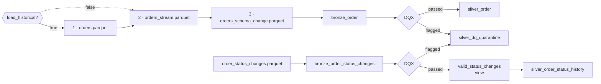
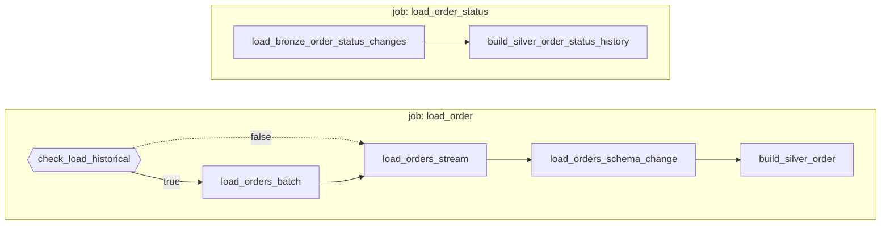

# Flow 05 — Orders

Three Parquet deliveries into one Bronze table, resolved to one row per order through a DQX gate, plus order status history as SCD Type 2.

Requirements: [flows/flows/05_orders.md](../../flows/flows/05_orders.md), plus the general rules in [docs/EXERCISE.md](../../docs/EXERCISE.md), [docs/DATA_MODEL.md](../../docs/DATA_MODEL.md) and [docs/INGESTION_PLAN.md](../../docs/INGESTION_PLAN.md).

## What gets built

| Layer | Object | Source | Write mode | Notebook |
|---|---|---|---|---|
| Bronze | `bronze_order` | `orders.parquet` | append | `01_load_bronze_order.py` |
| Bronze | `bronze_order` | `orders_stream*.parquet` | append, Auto Loader | `02_load_bronze_order_stream.py` |
| Bronze | `bronze_order` | `orders_schema_change.parquet` | append + `mergeSchema` | `03_load_bronze_order_schema_change.py` |
| Silver | `silver_order` | `bronze_order` | merge on `order_id` | `04_build_silver_order.py` |
| Silver | `silver_dq_quarantine` | flagged rows | append | `04_build_silver_order.py` |
| Bronze | `bronze_order_status_changes` | `order_status_changes*.parquet` | append, Auto Loader | `05_load_bronze_order_status_changes.py` |
| Silver | `silver_order_status_history` | `bronze_order_status_changes` | `AUTO CDC`, SCD 2 | `06_silver_order_status_history.py` |
| Gold | `fact_order` | `silver_order` | full overwrite | `07_build_gold_fact_order.py` |

Bronze in schema `bronze_raw`, Silver in `silver`, catalog per bundle target. Dev mode prefixes schemas with `dev_<user>_`.

`silver_dq_quarantine` is shared across sources and not owned by flow 05 — don't drop it when rebuilding.



## The deliveries

| File | Rows | Orders | `sales_channel` |
|---|---|---|---|
| `orders.parquet` | 30 | `O-0001`–`O-0030` | no |
| `orders_stream.parquet` | 8 | `O-0023`–`O-0030` | no |
| `orders_schema_change.parquet` | 8 | `O-0001`–`O-0008` | yes — 3 `web`, 5 `mobile` |
| `orders_stream_bad_data.parquet` | 2 | `O-9001`–`O-9002` | no |

So `bronze_order` holds 48 rows: the second and third files replay rows the first already delivered, and only `sales_channel` is new. Silver resolves that.

### The fourth file is deliberately invalid

`orders_stream_bad_data.parquet` exists so that a run of this project produces a real quarantine row, which EXERCISE deliverable 6 asks for. Without it the quarantine stays empty, because every row in the other three files passes all 46 rules.

Its name is load-bearing: step 2's Auto Loader filters on `orders_stream*.parquet`, so the file is picked up by the existing stream with no code of its own, and the checkpoint loads it exactly once. Its schema is identical to `orders_stream.parquet` — the same nine columns, the same types, `currency` and `order_amount` under their Bronze names — because Auto Loader runs with `schemaEvolutionMode: addNewColumns` and a stray column would evolve the table rather than be rejected.

Each row breaks exactly one `error` rule and nothing else:

| Order | Value | Rule |
|---|---|---|
| `O-9001` | `quantity = 0` | `quantity_is_not_positive` |
| `O-9002` | `currency = XXX` | `currency_code_not_in_bronze_currency` |

Everything else on both rows is valid, including a real `product_id` and `customer_id`, so no warning fires and each quarantine row names one reason rather than a list.

Both are errors rather than one error and one warning, and that is the point: an `error` row never reaches Silver, so `silver_order` stays at 30 orders and every number in Gold, in the marts and on the dashboard is unchanged by this file. A `warn` row would have reached Silver and shifted all of them.

## Jobs

Three resource files, one resource each, which is the convention `databricks bundle validate` expects:

| File | Resource |
|---|---|
| [flow05_order_job.job.yml](../../resources/flow05_order_job.job.yml) | the `load_order` job |
| [flow05_order_status_job.job.yml](../../resources/flow05_order_status_job.job.yml) | the `load_order_status` job |
| [flow05_order_status_pipeline.pipeline.yml](../../resources/flow05_order_status_pipeline.pipeline.yml) | the `order_status_history` pipeline |

Notebook tasks on serverless environment 6, plus the pipeline for `AUTO CDC`, which is pipeline-only. No triggers — these are fixed files, not a folder receiving deliveries, and flow 05 specifies none.

`build_gold_fact_order` is the last task of `load_order`, after Silver. `fact_order` is watched by flow 06's mart job, so publishing it starts a mart rebuild five minutes later.



Two jobs because the halves share no data, so either can be rebuilt without the other.

### `load_historical`

`orders.parquet` is a backfill, so step 1 sits behind an if/else gate. Default `"false"`: steps 2, 3 and 5 run, step 1 is excluded. Pass `"true"` and all four run, in order.

`load_orders_stream` depends on **two** things, and exactly one is live either way — `load_orders_batch` when the gate is `true`, the `outcome: "false"` edge when it is not. Both are needed because a task whose dependencies are *all* excluded is excluded itself, whatever its `run_if`; with one live dependency, `run_if: ALL_DONE` takes effect. The `outcome` is mandatory — the Jobs API rejects a dependency on an if/else condition without one.

The gate is about intent, not duplicates: step 1 would exit on its own guard anyway if `orders.parquet` were already loaded.

## Bronze

Each notebook reads one delivery via `pathGlobFilter`, because the orders folder also holds the status feed, whose columns are unrelated. No schemas are given — Parquet declares its own types; casting happens in Silver.

**Step 1** — batch read, no checkpoint needed for a single known file.

**Step 2** — Auto Loader, with its own schema location and checkpoint (`_schemas/` and `_checkpoints/bronze_order_stream`, outside `data/` so writing them is not mistaken for an arrival). `schemaEvolutionMode` is stated as `addNewColumns` rather than left to the default, which is conditional. `_rescued_data` is dropped: keeping it would make the stream the only writer bringing a column `bronze_order` lacks, and this workspace refuses automatic schema migration.

**Step 3** — batch read, append with `mergeSchema`, which is the schema evolution the step exists for. Runs last so the widening is a recorded event: the table exists without `sales_channel` before this adds it.

### Idempotency

Append alone would re-add 38 rows per run, so steps 1 and 3 check whether their file name is already among the table's `source_file` values and exit without writing if it is. Step 2 needs no guard — Auto Loader's checkpoint does it. So `bronze_order` stays at 46 rows however often the job runs.

That does **not** make Bronze one row per order. The guards stop a re-run duplicating a delivery; they cannot stop the deliveries overlapping each other. Step 5's dedupe does that.

### The two `mergeSchema` options

Different options, opposite failure modes:

- **Read side**, `spark.read.option("mergeSchema", "true")` — reading many Parquet files in one call does not union their schemas. Spark takes one file's footer, so a column only some files carry can vanish with no error. Each notebook sidesteps this by reading a single file.
- **Write side**, `.option("mergeSchema", "true")` on the append — Delta writes `NULL` for a column the table has and the DataFrame lacks, but *rejects* the reverse. So step 3 cannot land without it, and it fails loudly. It is a writer option, not a Spark conf, so the serverless conf allowlist does not apply.

## Silver

`silver_order` answers "what is this order now"; `silver_order_status_history` answers "what happened to it". Kept separate — `status` here is the one `bronze_order` carries.

**Dedupe:** one row per `order_id`, ordered by `ingested_at` then `order_date` descending, so the most recently ingested row wins.

**Cast and rename** to `FACT_ORDER`, which renames two columns:

| `bronze_order` | `silver_order` | |
|---|---|---|
| `order_id` | `order_id` | `STRING NOT NULL`, merge key |
| `customer_id` | `customer_id` | `BIGINT` → `INT` |
| `product_id` | `product_id` | |
| `currency` | **`currency_code`** | renamed |
| `order_date` | `order_date` | `STRING` → `DATE` |
| `quantity` | `quantity` | `BIGINT` → `INT` |
| `unit_price` | `unit_price` | → `DECIMAL(18,2)` |
| `order_amount` | **`net_amount`** | renamed, → `DECIMAL(18,2)` |
| `status` | `status` | `lower(trim(...))` |
| `sales_channel` | `sales_channel` | nullable, not a `FACT_ORDER` column |
| `source_file` | `source_file` | carried through — which delivery won the dedupe |
| `ingested_at` | `ingested_at` | carried through — when the row was *delivered*, not when Silver was built |

`source_file` and `ingested_at` are carried through for a reason beyond lineage: they are the only record of **which delivery won the dedupe**. Once Silver is written that decision is otherwise gone — Bronze holds every delivery of an `order_id`, so joining back cannot say which was kept without re-running the dedupe. Neither column belongs in Gold: `FACT_ORDER` is the Gold shape, so `fact_order` should name its columns rather than `SELECT *`.

**Write mode:** `MERGE` on `order_id` through the Delta Python API, because the source is the DataFrame DQX returns and a temp view is ruled out by `EXERCISE.md`. `MERGE` needs one row per key, which the dedupe guarantees.

Three clauses, not two. `whenMatchedUpdateAll` and `whenNotMatchedInsertAll` only add and update, so a row that was valid, reached Silver, and has since stopped passing — because a rule tightened, or its reference data changed, or it was removed from Bronze — would stay in the table for ever. `whenNotMatchedBySourceDelete` removes it, so Silver holds exactly what the gate currently passes.

That means Silver mirrors the gate, so an empty valid set empties the table — the same exposure every gate written with a full overwrite already has, with `RESTORE TABLE ... TO VERSION AS OF` as the way back.

One path to an empty valid set is guarded rather than left to time travel. `require_references` in [src/common/dq.py](../common/dq.py) fails the task if a reference frame is empty, naming the table. A `foreign_key` check cannot tell "this value is wrong" from "the reference was never loaded" — it only reports "not found" — so an empty `bronze_currency` would fail the currency rule for every order, and since that rule is an `error` and this write can delete, `silver_order` would be emptied by a run that looked successful. It is the one gate where that combination exists; everywhere else the foreign keys are warnings, so an empty reference flags every row but costs no data.

## Gold

`fact_order` is a projection: the nine columns `FACT_ORDER` declares, in its order, and nothing else. Published by the `load_order` job after Silver, with no quality gate of its own — the project's rules put DQX at the Bronze to Silver boundary.

Full overwrite rather than a merge. The fact is the whole of its source, and because `silver_order`'s merge deletes any row the gate stops passing, an overwrite here keeps the two in step: a row that leaves Silver leaves Gold in the same run.

Three columns stop at Silver. `sales_channel` is the column the schema-change delivery added, and `FACT_ORDER` does not declare it; `source_file` and `ingested_at` are Bronze lineage carried into Silver so the dedupe's choice stays traceable, and they are not attributes of an order.

`silver_order_status_history` has no Gold table. DATA_MODEL lists it outside the ER diagram, and the status an order is in now is already on `fact_order`; the history is a separate feed that disagrees with the order files on ten of the twelve orders they share, so nothing in the star schema is derived from it.

## Data quality

Rules live in [checks/silver_order.yml](../../checks/silver_order.yml), shipped by the bundle and passed to the notebook as the `checks_path` parameter.

| Rule | Function | Category | Criticality |
|---|---|---|---|
| `order_id_is_null` | `is_not_null` | completeness | error |
| `order_id_is_not_unique` | `is_unique` | uniqueness | error |
| `quantity_is_not_positive` | `sql_expression` | validity | error |
| `net_amount_is_negative` | `sql_expression` | validity | error |
| `status_is_not_in_the_list` | `is_in_list` | validity | warn |
| `customer_id_not_in_silver_customer` | `foreign_key` | referential integrity | warn |
| `product_id_not_in_bronze_product` | `foreign_key` | referential integrity | warn |
| `currency_code_not_in_bronze_currency` | `foreign_key` | referential integrity | **error** |

`error` rows go to the quarantine and not to Silver; `warn` rows go to both. DQX's passing DataFrame carries no result columns, so `silver_order` keeps its declared shape.

The three foreign keys are not at the same level, and the test is whether the missing reference breaks a calculation or only a description. `customer_id` and `product_id` are descriptive — the join yields NULL attributes, every amount stays correct, so the order is usable and the gap is only recorded. `currency_code` is arithmetic: without a known currency there is no rate, `order_amount_pln` cannot be computed, and the order would sit in Gold with a NULL where a converted amount belongs, understating a PLN total silently. Silver is meant to be conformed, so that row is kept out.

An order held back this way is not lost — it stays in Bronze, which is replayable, and in the quarantine with its reason. Once the currency is in the reference data a re-run brings it into Silver. They point at Silver and Bronze tables, never Gold — Gold is built *from* Silver, so a check at this boundary cannot depend on it. `build_silver_order` therefore needs `silver_customer`, `bronze_product` and `bronze_currency` to exist.

`order_id_is_not_unique` cannot fire as things stand: the dedupe runs before DQX sees the data. It documents the invariant.

**`silver_dq_quarantine`** — one table for every source, told apart by `source_table`:

| Column | Type |
|---|---|
| `source_table` | `STRING NOT NULL` |
| `severity` | `STRING` — `error` or `warn` |
| `row_data` | `VARIANT` — the failing row, whole |
| `failed_checks` | `ARRAY<STRUCT<name, message>>` |
| `quarantined_at` | `TIMESTAMP` |

`VARIANT` because sources have different columns and one shared table cannot give each a typed schema. Its shape and the projection into it live in [src/common/dq.py](../common/dq.py), so no gate writes that SQL itself. `failed_checks` holds only name and message — DQX's own result struct has ten fields, most of them bookkeeping, and pinning it in DDL would couple the table to the library version.

## Order status history

`order_status_changes.parquet` is a real change feed: 27 rows for 12 orders (`O-0001`–`O-0012`), each with a `sequence_num`.

Of those 27 events, 4 are `cancelled`, and a cancellation closes an interval rather than inserting a row. So the history holds **23 rows for 12 orders, of which 8 have a current row** — the 4 cancelled orders keep their history and end with none:

```sql
SELECT count(*) AS history_rows,
       count(DISTINCT order_id) AS orders,
       count(DISTINCT CASE WHEN __END_AT IS NULL THEN order_id END) AS orders_with_current_row
FROM <catalog>.<silver_schema>.silver_order_status_history;
```

`05_...` lands it with Auto Loader, with `schemaEvolutionMode: rescue` so the recorded schema stays fixed and drift goes to `_rescued_data` — the table must stay append-only, because the pipeline reads it as a stream.

`06_...` is a pipeline source, not a notebook, and it declares four objects: a temporary view of the checked feed, a sink, the flow filling that sink, and the SCD2 table with its CDC flow.

```
bronze_order_status_changes
   ├── DQX valid ───→ valid_status_changes (view) ──[AUTO CDC]──→ silver_order_status_history
   └── DQX invalid ──→ sink ──→ silver_dq_quarantine
```

Two things about that shape are forced rather than chosen. The **view** exists because `create_auto_cdc_flow` takes its source as a name, not a DataFrame, so there is no point at which a checked frame can be handed to it. The **sink** exists because a pipeline cannot write outside itself: a pipeline source declares a graph of datasets the pipeline owns, and `create_sink` is the declared destination that lets the rejected rows reach the one shared quarantine table instead of a second, pipeline-owned one.

A view rather than a table is a deliberate reading of [docs/EXERCISE.md](../../docs/EXERCISE.md). Its rule is that a view is only allowed where a flow asks for one, and flow 05 does not — but the rule above it says every transformation must *end* in a real named table, and this one does, on both sides: `silver_order_status_history` and `silver_dq_quarantine`. Materialising the view instead would put a filtered copy of the Bronze feed in the Silver schema, with no business meaning of its own and no place in the data model.

Its rules are in [checks/silver_order_status_history.yml](../../checks/silver_order_status_history.yml): `order_id` and `sequence_num` not null as errors, the status list and the `order_id` foreign key as warnings. There is no uniqueness rule, and that is a runtime limit rather than a choice — `is_unique` is implemented with an unbounded `Window.partitionBy` aggregation, which Spark does not support on an append-mode streaming DataFrame, and this flow reads a stream because the CDC flow downstream needs one. A duplicate `(order_id, sequence_num)` is resolved by the CDC flow itself, which keeps the last by sequence.

The CDC flow itself: `KEYS (order_id)`, `SEQUENCE BY sequence_num`, `STORED AS SCD TYPE 2`, `APPLY AS DELETE WHEN status = 'cancelled'`. `sequence_num` rather than `changed_at`, because the integer orders the changes exactly where several sharing a date would not. A delete closes the open interval rather than removing rows, so a cancelled order keeps its history and ends with no current row — `__END_AT IS NULL` is the current status. `except_column_list` drops the Bronze tracking columns, which would otherwise sit beside `__START_AT`/`__END_AT` and invite reading one as the other.

The feed contains `delivered`, which appears nowhere in `orders.parquet`, so `silver_order.status` and the history can legitimately disagree.

## Verify

```sql
-- Bronze, per delivery: 30/30/0, 8/8/0, 8/8/8, and 2/2/0 for the bad-data file
SELECT source_file, count(*) AS row_count, count(DISTINCT order_id) AS order_count,
       count(sales_channel) AS sales_channel_set
FROM <catalog>.<bronze_schema>.bronze_order GROUP BY source_file ORDER BY source_file;

-- Silver: 30 rows, 30 orders, sales_channel on 8
SELECT count(*), count(DISTINCT order_id), count(sales_channel)
FROM <catalog>.<silver_schema>.silver_order;

-- Quality results
SELECT source_table, severity, count(*) FROM <catalog>.<silver_schema>.silver_dq_quarantine
GROUP BY source_table, severity;

-- Which delivery won the dedupe: the 8 replayed orders should show
-- orders_schema_change.parquet, which is why they have a sales_channel
SELECT order_id, source_file, sales_channel
FROM <catalog>.<silver_schema>.silver_order
WHERE order_id <= 'O-0008' ORDER BY order_id;
```

Schema evolution is recorded on step 3's write: `DESCRIBE HISTORY` shows `CREATE TABLE AS SELECT` (30), `STREAMING UPDATE` (8), then `WRITE` with `canMergeSchema: true` (8). There is no separate `ADD COLUMNS` entry — `mergeSchema` evolves the schema as part of the append.

All 30 real orders pass every rule. The quarantine holds two rows per Silver rebuild, both from `orders_stream_bad_data.parquet`, and they are the deliverable's worked example:

```sql
SELECT severity, c.name AS failed_check, c.message, row_data
FROM <catalog>.<silver_schema>.silver_dq_quarantine
LATERAL VIEW explode(failed_checks) AS c
WHERE source_table = 'bronze_order'
ORDER BY row_data:order_id
```

Two rows, severity `error`, one failed check each, with the message naming the offending value — `Value 'XXX' in column 'currency_code' not found in reference column 'currency_code'`.

Because they are errors, neither reaches Silver: `silver_order` has 30 orders, not 32.

The `warn` half of the gate — a row that reaches Silver *and* the quarantine — is not demonstrated by a file, because such a row would change every downstream number. It is covered by [tests/test_quality_gate.py](../../tests/test_quality_gate.py), which builds orders in memory, runs the real rule files over them, and asserts that an `error` row is kept out of Silver while a `warn`-only row reaches both. Reference frames are built in memory too, so no table is read and none is written.

```bash
uv run pytest tests/test_quality_gate.py
# 1 passed, 2 skipped
```

The one that passes validates all 46 rule definitions through DQX's own validator and needs no compute. The two that exercise the gate need a Spark session, and skip when the environment has none — compute is named in the Databricks profile (`serverless_compute_id = auto`, a `cluster_id`, or `SPARK_REMOTE`), never enabled implicitly.

## Design decisions

| Topic | Decision | Reason |
|---|---|---|
| Steps 1–3 as notebook tasks | job tasks, not pipeline flows | **Flow ordering.** Ordering flows inside a pipeline needs `append_flow`'s `depends_on`, which is Public Preview and cannot be enabled for serverless on Databricks Free Edition. Unordered, whichever delivery commits first decides whether `bronze_order` ever lacked `sales_channel`, so the widening might never be recorded. Between job tasks the same ordering is one `depends_on`. |
| Order of the three loads | chained with `depends_on` | Makes the widening a recorded schema change. The flow asks for no order and the data is identical either way. |
| Historical load | `load_historical` parameter + `condition_task` | `orders.parquet` is a one-off backfill, so a routine run should not touch it. |
| Idempotency guard on steps 1 and 3 | skip a file already in `source_file` | Unguarded, every re-run added 38 duplicate rows with no way to avoid it. |
| `source_file` + `ingested_at` in `silver_order` | carried through from Bronze | They are the only record of which delivery won the dedupe — otherwise that decision is lost on write, since Bronze holds every delivery of an `order_id`. `silver_invoice` already carries `ingested_at` beyond its `FACT_` shape, so this is consistent. Both are dropped when Gold builds `fact_order`. |
| "Latest" for the dedupe | `ingested_at`, then `order_date` | The flow says "keep the latest record per key" without defining latest. |
| Decimal precision | `DECIMAL(18,2)` | `DATA_MODEL.md` says `decimal` without one. Values are whole or 2dp, and `net_amount` is summed downstream after a conversion where float would drift. |
| `MERGE` with a delete clause | `whenNotMatchedBySourceDelete` | Without it the gate can keep a row out but never take one back out, so a row that stopped passing would stay in Silver for ever. With it, Silver is exactly the current valid set — at the cost that an empty valid set empties the table, which full-overwrite gates already risk and time travel already covers. |
| Guarding the reference tables | `require_references` before the gate | Only this gate has an `error`-level foreign key together with a write that can delete, so only here does an unloaded reference table empty Silver. It guards an observed failure, not a hypothetical one: a Bronze reference stayed empty because its file was in the wrong folder, and the load reported success because an Auto Loader stream with no new files is not an error. |
| Row validation in the notebook | only `order_id NOT NULL` in DDL | The flow says "validate keys and amounts" without saying what happens on failure; DQX owns that at this boundary. |
| `sales_channel` in `silver_order` | carried through, nullable | Not a `FACT_ORDER` column, but a late-delivered column must land nullable rather than be dropped. |
| Bronze landing for the status feed | separate `bronze_order_status_changes` | The pipeline could read the Parquet directly, but every Bronze row needs `source_file` and `ingested_at`. |
| Foreign key criticality | `warn` | A missing reference must not drop an order. |
| Quarantine location | `silver.silver_dq_quarantine` | Output of this boundary, and fits the `silver_<entity>` naming. |
| DQX version | pinned in one bundle variable | `silver_job_dependencies` in `databricks.yml`. DQX documents breaking changes between releases. |

## Deploy and run

The five Parquet files go in `/Volumes/<catalog>/<bronze_schema>/input_data/data/orders/`, which is `data/orders/` in the repo.

```bash
databricks bundle deploy -t dev

databricks bundle run load_order -t dev --params load_historical=true   # first run
databricks bundle run load_order -t dev                                 # routine runs
databricks bundle run load_order_status -t dev
```

Both jobs are safe to re-run and commit nothing when there is nothing new. `silver_customer`, `bronze_product` and `bronze_currency` must exist before `load_order`, for the foreign key checks.

To start `bronze_order` from scratch, which is what makes the schema evolution reproducible:

```sql
DROP TABLE IF EXISTS <catalog>.<bronze_schema>.bronze_order;
```

```python
root = "/Volumes/<catalog>/<bronze_schema>/input_data"
dbutils.fs.rm(f"{root}/_checkpoints/bronze_order_stream", True)
dbutils.fs.rm(f"{root}/_schemas/bronze_order_stream", True)
```

Then re-run with `load_historical=true`, or the 30-order snapshot will not come back.
