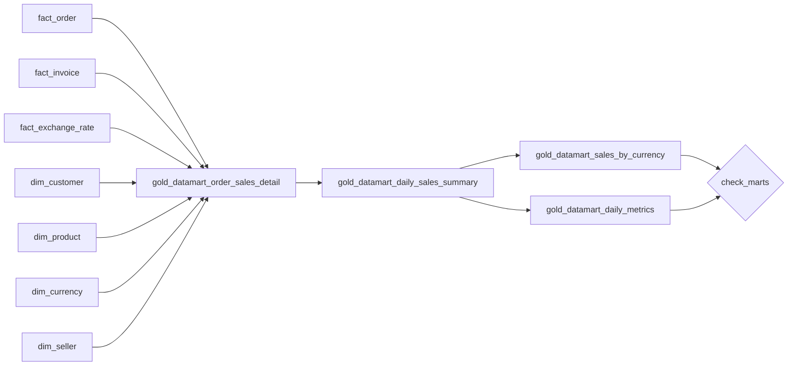

# Flow 06 — Data Quality, Cleaning & Joining

Joins the Gold star schema into one row per order, then aggregates it into the three reporting sinks the dashboard reads.

Requirements: [flows/flows/06_data_quality_cleaning_joining.md](../../flows/flows/06_data_quality_cleaning_joining.md), plus the general rules in [docs/EXERCISE.md](../../docs/EXERCISE.md), [docs/DATA_MODEL.md](../../docs/DATA_MODEL.md) and [docs/INGESTION_PLAN.md](../../docs/INGESTION_PLAN.md).

Flow 06 spans the whole project. Sections 1 and 2 — cleaning and DQX — are implemented in flows 01 to 05, at each one's Bronze to Silver boundary; see [Where sections 1 and 2 live](#where-sections-1-and-2-live). This folder holds sections 3 and 4: the joining and the reporting sinks.

## What gets built

| Layer | Object | Type | Source | Write mode | Notebook |
|---|---|---|---|---|---|
| Gold | `gold_datamart_order_sales_detail` | table | the 7 star-schema tables | overwrite | `01_build_gold_datamart_order_sales_detail.py` |
| Gold | `gold_datamart_daily_sales_summary` | table | `gold_datamart_order_sales_detail` | overwrite | `02_build_gold_datamart_daily_sales_summary.py` |
| Gold | `gold_datamart_sales_by_currency` | table | `gold_datamart_daily_sales_summary` | overwrite + `overwriteSchema` | `03_build_gold_datamart_sales_by_currency.py` |
| Gold | `gold_datamart_daily_metrics` | table | `gold_datamart_daily_sales_summary` | overwrite | `04_build_gold_datamart_daily_metrics.py` |

All four live in schema `gold`, in the catalog chosen by the bundle target (`poc_dev`, `poc_test`, `poc`). In the `dev` target, development mode prefixes schema names with `dev_<user>_`.

`05_check_marts.py` writes nothing. It is the last task and it fails the job; see [The check task](#the-check-task).



## Job and trigger

Defined in [resources/flow06_gold_marts_job.job.yml](../../resources/flow06_gold_marts_job.job.yml). Notebook tasks only, on serverless environment version 6. No DQX dependency: the quality gates run in the jobs that write Silver.

| Task | Depends on |
|---|---|
| `build_gold_datamart_order_sales_detail` | — |
| `build_gold_datamart_daily_sales_summary` | `build_gold_datamart_order_sales_detail` |
| `build_gold_datamart_sales_by_currency` | `build_gold_datamart_daily_sales_summary` |
| `build_gold_datamart_daily_metrics` | `build_gold_datamart_daily_sales_summary` |
| `check_marts` | both sinks |

The two sinks are independent of each other and run in parallel.

Trigger: a table update trigger on the seven star-schema tables, `condition: ANY_UPDATED`, `wait_after_last_change_seconds: 300`.

Each flow job publishes one or two of those tables as its last task, and nothing otherwise connects those jobs to this one — a customer file arriving would refresh `dim_customer` and leave the marts on yesterday's numbers. Flow 07 requires the dashboard refresh to be driven by this job rather than by a schedule of its own, so this job has to be driven by the data.

`ANY_UPDATED` rather than `ALL_UPDATED`: the latter fires only once *every* table in the set has been updated since the last successful run, and `dim_seller` changes on its nightly schedule while `dim_currency` changes only when someone approves a currency, so it would almost never fire. `wait_after_last_change_seconds` resets on each update, so a round of loads touching several tables produces one rebuild rather than one per table.

None of the four `gold_datamart_*` tables is in the watched list. If one were, the job would fire on its own write and run forever.

`max_concurrent_runs: 1`, because every task overwrites its table in full. With the queue enabled, a trigger firing mid-run waits rather than being dropped.

One cadence to expect: `load_bronze_seller` runs nightly at 02:00 and rewrites `dim_seller` whether or not `sellers_delta/` received anything, so the marts rebuild once a night even when nothing changed.

## Section 3 — the joined mart

One row per `order_id`. `fact_order` is the spine; the other six tables hang off it with left joins, so an order with no invoice or no rate stays in the mart with NULLs rather than disappearing from the sales figures.

### What each join contributes

| Join | Delivers |
|---|---|
| `fact_invoice` | `invoice_id`, `seller_id`, `vat_amount`, `gross_amount` |
| `fact_exchange_rate` | `rate_to_pln`, which `order_amount_pln` is derived from |
| `dim_product` | `product_category` |
| `dim_currency` | the reporting currency's implied rate |
| `dim_customer` | nothing |
| `dim_seller` | nothing |

The last two are present because section 3's join table lists them, and DATA_MODEL's column list for this mart gives them nothing to land in: every key they would resolve is already carried by `fact_order` or by the invoice. No column is taken from either, so they cannot validate anything by themselves — the validation section 4 asks for is the `distinct` comparison in the check task. What they do contribute is indirect: a dimension with a duplicated key would multiply rows and break the grain, which the check task catches.

### Keeping the grain

Section 3 asks for the grain to be re-checked after the joins. Two of the six can multiply rows, and both are resolved **before** the join rather than checked after it:

- `fact_invoice` is one row per `invoice_id`, and nothing stops two invoices from carrying the same `order_id`. A `QUALIFY row_number()` keeps one — the latest `invoice_date`, then the highest `invoice_id` to break a tie — so the join is one-to-at-most-one by construction.
- `fact_exchange_rate` is matched on a range rather than an equality, so every rate published up to the order date qualifies. A second `QUALIFY row_number()` keeps the latest.

The four dimension joins depend on their keys being unique, which the `is_unique` DQX rule on each dimension's Silver table enforces upstream.

### Which rate an order converts at

The most recent rate published **on or before** the order date. Flow 06 asks for the nearest date rather than an equal one; nearest in either direction would let an order be converted at a rate published after it happened, which is not how a transaction is valued. An order dated before the first published rate for its currency gets no rate, and so no `order_amount_pln`.

In the current data every order date has a rate, so this resolves to an exact match throughout. It starts to matter when the API rows — which land under the date the job ran — sit alongside the historical ones, and on any future delivery with a gap.

The reporting currency is the exception. NBP does not publish the zloty against itself, so a PLN order would find no rate at all and lose its PLN amount — the one currency needing no conversion. Its rate is 1 by definition, taken from `dim_currency.is_reporting_currency` rather than from the literal `'PLN'`, so the mart follows the reference data if the reporting currency is ever changed.

### `product_category`

Not in DATA_MODEL's column list for this mart, but section 3's diagram groups this table by category to build the daily summary, and DATA_MODEL names this table as that summary's only source. The column has to be here for both statements to hold, and it is what makes the `dim_product` join deliver something.

## Section 3 — the daily summary

One row per `sales_date` + `currency_code` + `product_category`, aggregated from the mart above and from nothing else.

**Cancelled orders are excluded.** `net_sales` is a revenue measure and a cancelled order is not revenue. Six of the thirty orders are cancelled, 649.51 of 6240.03 PLN, so including them would report a tenth of the total as sales that did not happen. `DAILY_SALES_SUMMARY` has no status column and no separate measure, so there is nowhere for the distinction to live if the rows are counted in.

This is a deliberate deviation: the requirement says "grouped by", with no filter.

The status is `fact_order`'s, which is the current status the order files carry. `order_status_changes.parquet` is a separate feed with its own view of the same orders — the two disagree on ten of the twelve orders they share, and their cancelled sets do not overlap at all — but it has no amounts on it and so cannot define what is subtracted from a total. It is kept apart in `silver_order_status_history`, as flow 05 requires.

What the exclusion costs: a date, currency and category whose every order was cancelled produces no row rather than a row of zeros. A day with no orders was already absent, so any query reading this table has to handle a missing row either way — including flow 07's alert on an `order_count` of zero.

**Two measures do not cover the same orders.** `net_sales` and `sales_pln` come from `fact_order` through the detail mart, so they cover every order that passed the gate. `gross_sales` comes from the invoice, which an order may not have; `sum` skips the NULL, so `gross_sales` covers only invoiced orders. In the current data every order has exactly one invoice and the two agree, but the asymmetry is in the grain of the sources, not in the query.

**Exactly five measures.** Section 4 unpivots "`gold_datamart_daily_sales_summary`'s 5 measures", so a sixth would break the sink downstream.

## Section 4 — the reporting sinks

### `gold_datamart_sales_by_currency`

One row per date, one column per approved currency, plus the total across them. Built with the three operations section 4 names: `groupBy`, `pivot` and `withColumn`, in the DataFrame API rather than SQL, because `pivot` is where the requirement is.

**The pivoted measure has to be `sales_pln`.** The requirement asks for a total across currencies. Summing EUR, GBP and USD amounts into one number is not arithmetic — it adds quantities in different units. `sales_pln` is already converted, so every pivoted value is in the same unit and the total means something.

**The literal column.** `currency_base = 'PLN'`, added with `lit()`, is the literal-value column section 4 asks for. It is not a marker for its own sake: the pivoted columns are named after the currency the orders were placed in while the amounts in them are converted, and this column is what says so.

**The pivot's column list comes from `dim_currency`.** Passing it explicitly makes the shape depend on the approved reference data rather than on which currencies happen to have sold. Without it, `pivot` runs its own query to discover the distinct values and a currency with no sales anywhere in the data would silently have no column. `PLN` is exactly that case today: no orders are placed in zlotys, so the column is all NULLs — which is the honest answer.

This is the one Gold table with no declared DDL. Section 4 asks for one column per currency, so the shape follows the reference data by definition, and the write uses `overwriteSchema` so that adding a currency to `dim_currency` adds a column.

**NULL and zero are different here.** A currency column is NULL for a date with no non-cancelled orders in that currency, not 0 — the difference between "nothing sold" and "sold, summing to nothing". The total treats a NULL as 0, so it stays complete.

### `gold_datamart_daily_metrics`

The summary's five measures, one per row: `sales_date` + `currency_code` + `product_category` + `metric_name`, built with `unpivot`.

The measures are cast to `DECIMAL(18,2)` before the unpivot. `unpivot` collapses several columns into one, so they have to share a type; left alone Spark would pick one on its own, and casting makes `metric_value`'s type a decision in the notebook instead of a consequence of which measures are listed. A count is a whole number in `DECIMAL(18,2)`.

**`metric_value` has no unit.** A row holding 4 items and a row holding 255.98 PLN look alike, and only `metric_name` tells them apart. Nothing downstream may sum across `metric_name`.

## The check task

`05_check_marts.py` runs the three checks sections 3 and 4 ask for, writes nothing, and fails the job if any of them fails.

It is a task of its own rather than code at the end of the notebooks that write the tables. A check at the end of a build runs after the write has committed, so it can only report a table it has no power to stop. Here a failure fails the job, and flow 07's dashboard refresh and alerts — which hang off this job — do not run against numbers that did not add up.

| Check | Requirement | How |
|---|---|---|
| Grain and cardinality | §3: "re-check the grain stays one row per `order_id`", "confirm cardinality per join" | the mart's rows, its distinct `order_id` and `fact_order`'s rows must all be equal |
| Currency codes | §4: "use `distinct` only to validate inputs … not as a table of its own" | `distinct` on the mart's `currency_code`, compared to `dim_currency` and discarded |
| Reconciliation | §4: `SUM(metric_value)` for `net_sales` against `SUM(net_sales)` | both sides are `DECIMAL`, so the comparison is exact |

The first check answers both halves of the §3 requirement, because they are the same question asked two ways — did any of the six joins multiply rows. More rows than distinct ids means a join fanned out; fewer rows than `fact_order` means a join dropped orders.

All three are evaluated before anything is raised, so one run reports every failure it found instead of stopping at the first.

**Orphan foreign keys are deliberately not checked here.** A `customer_id` or `seller_id` absent from its dimension is a completeness question, and the DQX gates already report it as a warning at the Bronze to Silver boundary where the row enters. Failing the Gold publish for it would make a warning fatal two layers later.

## Where sections 1 and 2 live

Section 1's cleaning and section 2's DQX gates are implemented per flow, at each one's Bronze to Silver boundary, not here.

| Requirement | Where |
|---|---|
| Normalise headers, cast every Bronze string column | each flow's Silver notebook |
| One dedup pass per table, with "latest" defined | each flow's Silver notebook |
| A column delivered later lands nullable, old rows NULL | flow 05, `sales_channel` |
| Quarantine invalid rows and log why | `silver_dq_quarantine`, shared |
| Flatten the customer hierarchy once, in Silver | flow 03 |
| DQX at the Bronze to Silver boundary | all eight gates |
| One shared quarantine table | `silver_dq_quarantine` |

45 rules in eight files under [checks/](../../checks):

| File | Rules | Completeness | Uniqueness | Validity | Referential |
|---|---|---|---|---|---|
| `silver_order.yml` | 8 | 1 | 1 | 3 | 3 |
| `silver_invoice.yml` | 9 | 6 | 1 | 1 | 1 |
| `silver_seller.yml` | 6 | 2 | 2 | 1 | 1 |
| `silver_exchange_rate.yml` | 5 | 2 | 1 | 1 | 1 |
| `silver_customer.yml` | 5 | 2 | 1 | 1 | 1 |
| `silver_order_status_history.yml` | 4 | 2 | — | 1 | 1 |
| `silver_currency.yml` | 4 | 2 | 1 | 1 | — |
| `silver_product.yml` | 4 | 2 | 1 | 1 | — |

`silver_currency` and `silver_product` have no referential rule because neither references anything: currency *is* the reference table, and the product catalogue resolves against nothing.

`silver_order_status_history` has no uniqueness rule because none can be expressed there. `is_unique` compiles to a window partitioned by the key columns with an unbounded frame, and Structured Streaming rejects a non-time window; that gate reads a stream because `AUTO CDC` requires a streaming source, and DQX 0.16.0's `is_unique` takes no watermark or window argument. `AUTO CDC` resolves a duplicated key itself, keeping one row, so the history cannot gain a duplicate interval — what is lost is the report, not the correctness.

The shape of `silver_dq_quarantine` and the projection into it live in [src/common/dq.py](../common/dq.py), so no gate writes that SQL itself.

## Design decisions not specified in the requirements

| Topic | Decision | Reason |
|---|---|---|
| Cancelled orders | Excluded from the summary and everything downstream | `net_sales` is a revenue measure; a tenth of the PLN total would otherwise be sales that did not happen. The detail mart keeps every order, so flow 07's status mix still has its source. |
| `product_category` on the detail mart | Added, beyond DATA_MODEL's column list | Section 3 groups this table by category and DATA_MODEL names it as the summary's only source; both cannot hold without it. |
| Nearest rate | Most recent on or before the order date | A transaction is not valued at a rate published after it happened. |
| Reporting currency rate | 1, from `is_reporting_currency` | NBP does not publish PLN against itself, so a PLN order would otherwise lose its PLN amount. Read from the dimension rather than written as `'PLN'`. |
| Invoice per order | Latest `invoice_date`, then highest `invoice_id` | `fact_invoice`'s key is `invoice_id`; nothing stops two invoices per order, so the grain is made structural rather than assumed. |
| `sales_by_currency` source | The summary, not the detail mart | Section 4 writes the column as `order_date`, but reading the summary keeps both sinks on the same cancelled-order decision — otherwise the same day carries two different sales figures depending on which table is asked. |
| `sales_by_currency` schema | Not declared; `overwriteSchema` | Section 4 asks for one column per currency, so the shape follows `dim_currency` by definition. |
| Clustering | `(sales_date, currency_code)`, and `(sales_date, metric_name)` for the metrics | The columns flow 07 parameterises the dashboard by, and the way a panel reads the metrics table: one measure over a date range. |
| `order_count` | `count(*)` | The detail mart is one row per order by construction, so a distinct count would be equal and more expensive. |
| Marts as tables, not materialized views | Tables | Flow 07 requires a Dashboard task depending on `build_gold_datamart_daily_sales_summary` by name; a materialized view refreshes through a pipeline, and the dependency would be on the pipeline rather than on that table. The pivot's column list is also discovered at runtime, which fights a view's fixed schema. Incremental refresh would have supported this query — `QUALIFY` and window functions are eligible when the partition columns are given — so the reason is the job graph, not the SQL. |
| Trigger | `table_update`, `ANY_UPDATED`, 300s | Nothing else connects the seven flow jobs to this one, and flow 07 requires this job to drive the dashboard. `ALL_UPDATED` would wait for dimensions that change nightly or on approval. |

## Deploy and run

```bash
databricks bundle validate -t dev
databricks bundle deploy -t dev
databricks bundle run build_gold_marts -t dev
```

The job needs the seven star-schema tables to exist, so the five flow jobs have to have run at least once first.

## Verify

Against the thirty orders currently in the volume:

| Table | Rows | Checks |
|---|---|---|
| `gold_datamart_order_sales_detail` | 30 | one per `order_id`; `net + vat = gross` on all; `net = quantity × list_price` on all; every rate equals the published rate for the order's own date |
| `gold_datamart_daily_sales_summary` | 24 | `order_count` 24, `item_quantity` 55, `net_sales` 1272.00, `gross_sales` 1564.58, `sales_pln` 5590.52 |
| `gold_datamart_sales_by_currency` | 17 | `total_pln` sums to 5590.52, matching the summary; the `PLN` column is all NULL |
| `gold_datamart_daily_metrics` | 120 | 24 × 5; `net_sales` sums to 1272.00 |

The summary's totals are the detail mart's less the cancelled orders: 1411.50 − 139.50 = 1272.00, and 6240.03 − 649.51 = 5590.52.

At this volume the summary aggregates almost nothing — 24 non-cancelled orders fall into 24 groups, so `order_count` is 1 in every row. The pivot is the first step where rows genuinely combine: the 24 groups become 17 dates.
