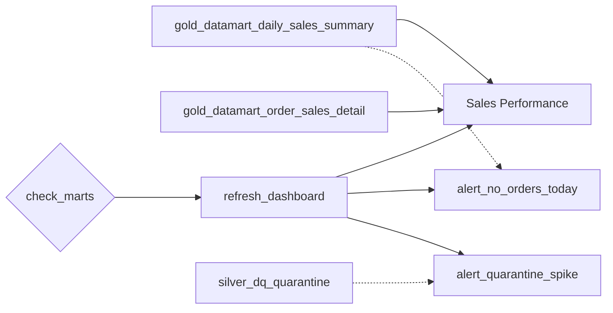

# Flow 07 — Dashboard and Alerts

A Lakeview dashboard on the two Gold marts, refreshed by the mart job, with two alerts evaluated after the refresh.

Requirements: [flows/flows/07_dashboard.md](../../flows/flows/07_dashboard.md), plus the general rules in [docs/EXERCISE.md](../../docs/EXERCISE.md).

Flow 07 owns no notebook and writes no table. Its three tasks are the tail of `build_gold_marts`, the job flow 06 defines, which is what flow 07 calls "the Gold build job".

## What gets built

| Object | Type | Resource | Source |
|---|---|---|---|
| `Sales Performance` | Lakeview dashboard | [flow07_sales_dashboard.dashboard.yml](../../resources/flow07_sales_dashboard.dashboard.yml) | [sales_performance.lvdash.json](sales_performance.lvdash.json) |
| `no_orders_today` | SQL alert | [flow07_no_orders_today.alert.yml](../../resources/flow07_no_orders_today.alert.yml) | — |
| `quarantine_spike` | SQL alert | [flow07_quarantine_spike.alert.yml](../../resources/flow07_quarantine_spike.alert.yml) | — |

In the `dev` target, development mode prefixes the dashboard with `[dev <user>]`.



## Tasks

The last three tasks of `build_gold_marts`:

| Task | Type | Depends on |
|---|---|---|
| `refresh_dashboard` | `dashboard_task` | `check_marts` |
| `alert_no_orders_today` | `alert_task` | `refresh_dashboard` |
| `alert_quarantine_spike` | `alert_task` | `refresh_dashboard` |

Flow 07's own task list names `build_gold_datamart_daily_sales_summary` as the refresh's dependency. It depends on `check_marts` instead, which depends on the summary transitively and adds one thing: a refresh cannot run on numbers the reconciliation rejected. The requirement is "only on success of" that build, and this is that condition plus one.

The dashboard has no schedule of its own and neither alert is evaluated by its own schedule, so this job is the only thing that refreshes or evaluates anything. That is what flow 07 asks for: "let the Gold job drive the refresh".

Both task types need a serverless or pro SQL warehouse, which notebook tasks do not. The `warehouse_id` variable in [databricks.yml](../../databricks.yml) resolves one **by name** at deploy time rather than carrying an id:

```yaml
warehouse_id:
  lookup:
    warehouse: "Serverless Starter Warehouse"
```

That is the warehouse Databricks Free Edition provides, 2X-Small, and it is the only one such an account has. No workspace-specific value lives in the repo, and a renamed warehouse fails the deploy by name rather than resolving to nothing.

Free Edition also caps concurrent job tasks at five per account. This job never runs more than two at once — the two sinks, then the two alerts — so it fits.

## The dashboard

Four visualizations and two filters, over two datasets. It reads the Gold marts only, never Silver or Bronze.

| Widget | Dataset | Measure |
|---|---|---|
| Total Sales (PLN) by Date | summary | `sum(sales_pln)` by `sales_date` |
| Total Sales (PLN) by Currency | summary | `sum(sales_pln)` by `currency_code` |
| Total Sales (PLN) by Product Category | summary | `sum(sales_pln)` by `product_category` |
| Number of Orders by Status | detail | `count(*)` by `order_status` |

The status mix has to come from the detail mart. It is the only one of the two carrying `order_status`, and the summary excludes cancelled orders, so a status mix built from it would have no cancelled slice to show. That is why flow 07 names two tables as the dashboard's sources rather than one.

Every total is `sales_pln` or `order_amount_pln`. `net_sales` and `gross_sales` are in the order's own currency and summing them across currencies adds quantities in different units.

### Filters

A date range filter and a single-select currency filter, both applying to all four visualizations.

The date filter binds to two different columns — `sales_date` in the summary and `order_date` in the detail — because the two marts name the day differently. The detail dataset declares `order_date` and `currency_code` as dimensions for no other reason: without them the filters have nothing to bind to on that dataset, and the status chart would stay unfiltered while the other three filtered. Three filtered widgets beside one unfiltered one is worse than no filters, because the page then shows "January, EUR only" next to "all orders, all time".

### Catalog and schema

The dataset sources in the `.lvdash.json` are **unqualified** — `gold_datamart_daily_sales_summary`, not `poc_dev.dev_user_gold.gold_datamart_daily_sales_summary` — and the resource supplies the context:

```yaml
dataset_catalog: ${var.catalog}
dataset_schema: ${resources.schemas.gold.name}
```

Two facts make this the only way to do it. Bundle variable substitution does not reach inside the `.lvdash.json`; a `${var.catalog}` written there is sent as literal text. And `dataset_catalog` and `dataset_schema` override the *default* catalog and schema, so a fully qualified source is not overridden at all.

The consequence is that the dashboard deploys into whichever schema the target names, including another user's `dev_<their_user>_gold`. Without it, anyone else deploying this bundle would get a dashboard pointing at the original author's tables.

The round trip to watch: the dashboard editor picks datasets from the catalog, so authoring in the UI and exporting again re-qualifies the sources. Strip them back before committing.

Requires CLI 0.281.0 or newer, where `dataset_catalog` and `dataset_schema` were added.

## The alerts

| Alert | Query | Condition |
|---|---|---|
| `no_orders_today` | `coalesce(sum(order_count), 0)` on the summary, `sales_date = current_date()` | `= 0` |
| `quarantine_spike` | `count(*)` on `silver_dq_quarantine`, `quarantined_at >= current_date()` | `> 0` |

`coalesce` is load-bearing in the first. The summary has one row per date, currency and category, and a date with nothing loaded has no row at all rather than a row of zeros — so `sum()` over no rows returns NULL, and NULL is not equal to 0. Without it the alert would stay silent on exactly the day it exists to catch.

Both alerts carry a schedule, because the API requires one, and both schedules are `PAUSED`. An unpaused schedule would evaluate the alert against whatever happened to be in the table at the time, which is the stale evaluation flow 07 rules out. The job task evaluates the alert independently of its schedule, so pausing it costs nothing.

The notification destination is `subscribers` on the task, resolved to `${workspace.current_user.userName}` so no address is committed to the repo. It cannot live on the alert: the `alerts` resource has no subscriber field at all. Flow 07 asks for a real destination because "an alert nobody receives is the same as no alert".

### `alert_task`, not `sql_task`

Written as `sql_task` with a nested `alert`, both tasks fail with

```
The SQL entity could not be found. Please check that the entity exists and is
accessible by the 'Run as' principal
```

for an alert that exists and whose id resolved correctly. The bundle's `alerts` resource creates an Alerts v2 object, which lives at `/sql/alerts-v2/{id}`, while the nested `sql_task.alert` resolves an id against the older `/sql/alerts/` path. `alert_task` is the task type that resolves the v2 path; the CLI has translated paths for it since 0.299.0. Do not fold these back into `sql_task`.

## Design decisions not specified in the requirements

| Topic | Decision | Reason |
|---|---|---|
| Refresh dependency | `check_marts`, not the summary build | Flow 07 asks for "on success of" the summary; depending on the check is that plus the reconciliation, so a refresh cannot publish numbers that did not add up. |
| Warehouse | A `lookup` by name, not an id | No workspace-specific value in the repo, and a rename fails the deploy by name. |
| Alert schedules | Set and paused | The API requires the field; the job must be the only evaluator. |
| Quarantine threshold | 0 | There is no measured normal rate to calibrate a tolerance against, and choosing one would decide in advance how many rejected rows are acceptable. |
| Notification | `subscribers` on the task, current user | The alert resource has no subscriber field, so the task is the only place; the substitution keeps the address out of the repo. |
| Dashboard authoring | UI, then exported | Databricks documents the `.lvdash.json` as generated, not hand-edited. |

## Deploy and run

```bash
databricks bundle validate -t dev
databricks bundle deploy -t dev
databricks bundle run build_gold_marts -t dev
```

The job needs the marts, so flows 01 to 05 have to have run first. In normal operation nothing is run by hand: the table update trigger on `build_gold_marts` fires five minutes after any Gold table changes, and the three tasks here follow.

## Verify

On the thirty orders in `data/`, the dashboard shows:

| Widget | Expected |
|---|---|
| by Date | 17 points, 2026-01-02 to 2026-01-30, summing to 5590.52 PLN |
| by Currency | GBP 1980.39, EUR 1971.11, USD 1639.02 |
| by Category | apparel 3887.78, home 1027.04, stationery 438.78, accessories 236.92 |
| by Status | paid 13, shipped 11, cancelled 6 |

The first three exclude cancelled orders, because the summary does. The fourth includes them, because the detail mart does — the two are built from different tables on purpose, and the 30 orders in the status chart against 24 behind the other three is that difference, not an error.

Both alerts are **triggered** on this data:

`no_orders_today` reports 0, because every order is dated January 2026 and `current_date()` has none. That is the requirement read literally — it is a freshness check, and the data genuinely is stale — so the alert is red by design until a delivery arrives with a current date.

`quarantine_spike` reports two rows per Silver rebuild, from [orders_stream_bad_data.parquet](../../data/orders/orders_stream_bad_data.parquet), which exists so that a run produces the quarantine example EXERCISE deliverable 6 asks for. Both its rows break an error rule, so neither reaches Silver and none of the figures above is affected.

A triggered alert does not fail its task. The documented behaviour is "Succeeded: the alert was evaluated successfully, regardless of whether the alert condition was triggered or not", and `Failed` means the evaluation itself broke — a warehouse that would not start, or a query error. So the expected outcome of a healthy run is a green job with two red alerts, and the alert state is read in the alerts console, not from the job.
